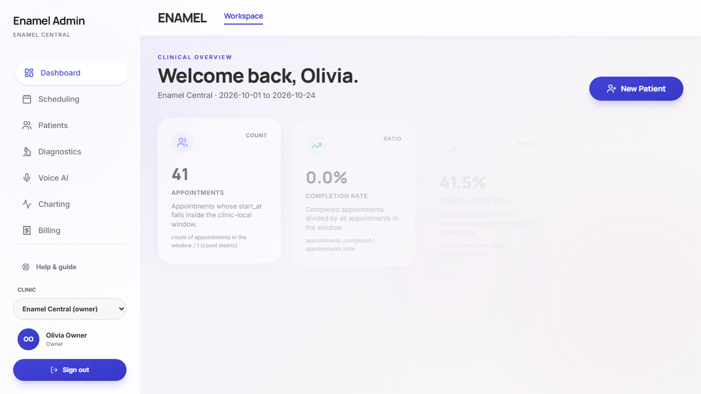
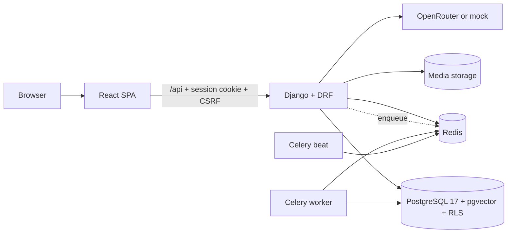

# Enamel

Enamel is a multi-tenant dental practice platform for small clinics: scheduling
and public booking, patient records and charting, treatment plans and consent,
imaging review, billing, a patient portal and analytics. It is built as a
portfolio project with Django, React and PostgreSQL, and it includes an
evaluated AI assistant and retrieval layer.

> **Status:** portfolio/demo software. It uses synthetic data and sandbox
> integrations, is **not clinically validated**, and must not be used with real
> patient data.

[](https://www.python.org/)
[](https://www.djangoproject.com/)
[](https://react.dev/)



*The staff workspace with synthetic demo data.*

## What it does

| Workflow | Included |
|---|---|
| Front desk | Provider and operatory scheduling, availability rules, public booking with holds, waitlist offers, reminders and recall |
| Clinical | Patient records, allergies and medical history, encounters, FDI odontogram, imaging archive and previews, treatment plans, consent and documents |
| Revenue | Invoices, payments and refunds with a sandbox gateway, receipt documents, insurance/RCM behind a feature flag |
| Patient | A separate patient portal with one-time-code sign-in, own appointments, records, plans, invoices and documents, plus a PWA shell |
| Operations | Tenant-scoped analytics, an append-only audit chain, durable jobs, and PostgreSQL row-level security |
| AI | A tool-calling assistant with identity and confirmation gates, grounded retrieval with citations, an offline evaluation suite, a no-show model and a fixture-only imaging heuristic |

External providers are **not live** in this repository. Payments use a sandbox,
messaging and e-signature use local/dev adapters, the PMS connector is a
simulator, the voice engine is a simulator, and the AI provider defaults to a
deterministic mock. The patient-portal one-time code is handled by a dev adapter
(it logs the code) or shown explicitly in demo mode.

## Architecture



In the production-shaped stack, the API runs as the non-superuser `enamel_app`
role and the worker as `enamel_worker`; PostgreSQL row-level security is enabled
and forced, and migrations run as the owner in a separate process. The platform
admin is a separate service on a loopback port and is not part of the public web
tier.
See [`docs/deployment/DEPLOYMENT_GUIDE.md`](docs/deployment/DEPLOYMENT_GUIDE.md)
for the deployment topology and [`backend/README.md`](backend/README.md) for the
backend layout.

## Tech stack

| Layer | Technology |
|---|---|
| Backend | Python 3.14, Django 6.1, Django REST Framework, drf-spectacular |
| Data | PostgreSQL 17 + pgvector, Redis 7 |
| Background | Celery worker and beat, durable `JobRequest` rows in PostgreSQL |
| Frontend | React 19, Vite, TypeScript, Tailwind CSS, TanStack Query |
| AI/ML | Provider abstraction (OpenRouter or deterministic mock), optional local ONNX embeddings, scikit-learn |
| Imaging | pydicom, Pillow, DICOM archive with de-identification |
| Delivery | Docker Compose, nginx, gunicorn, GitHub Actions |

## Quick start

Requirements: Python 3.14, Node.js 24 with pnpm 11, and Docker.

```powershell
# 1. Database and Redis (host ports 5433 and 6380)
docker compose -f deploy/docker-compose.yml up -d db redis

# 2. Backend
python -m venv .venv
.\.venv\Scripts\python.exe -m pip install -r backend\requirements.txt
cd backend
..\.venv\Scripts\python.exe manage.py migrate
..\.venv\Scripts\python.exe manage.py seed_demo
..\.venv\Scripts\python.exe manage.py runserver 127.0.0.1:8000
```

On macOS/Linux, activate the environment and use `python manage.py ...` in the
same order.

```powershell
# 3. Frontend (second terminal, repository root)
pnpm install
pnpm --filter @workspace/enamel-landing run dev
```

Open <http://127.0.0.1:5173>. The Vite dev server proxies `/api` to Django.

The seeded demo owner is `owner@enamel.demo` with password
`EnamelDemo!2026`; `dentist@enamel.demo`, `reception@enamel.demo` and
`assistant@enamel.demo` use the same password. All data is synthetic.

## Configuration

Copy the example file for the delivery mode you are using:

- Local development: [`env.example`](env.example) (optional; `config/settings/dev.py`
  has loopback defaults).
- Production-shaped Compose: [`deploy/env.example`](deploy/env.example).

Production settings fail closed without `SECRET_KEY`, `ALLOWED_HOSTS`, the two
webhook secrets and a valid `CONNECTOR_KEY`. Never commit `.env` files; they are
ignored. `deploy/.env` is the only file the Compose stack reads.

## Development and testing

Run from `backend/` unless noted.

```powershell
..\.venv\Scripts\python.exe -m pytest -q
..\.venv\Scripts\python.exe manage.py check
..\.venv\Scripts\python.exe manage.py makemigrations --check
..\.venv\Scripts\python.exe -m ruff check .
```

```powershell
# repository root
python scripts\check_rls.py
pnpm run typecheck
pnpm run build
pnpm --filter @workspace/enamel-landing run test
pnpm run codegen:check
```

The end-to-end suite needs the running stack:

```powershell
$env:E2E_BASE_URL = "http://localhost:8090"
pnpm exec playwright test
```

The production-shaped Compose stack is described in the deployment guide;
operator-only smoke helpers stay private. Machine-learning, retrieval and
evaluation commands are in [`docs/AI-EVALUATION.md`](docs/AI-EVALUATION.md).

## Deployment

There is **no hosted deployment yet**. The verified local path is the
production-shaped Compose stack in `deploy/docker-compose.yml`; the
[deployment guide](docs/deployment/DEPLOYMENT_GUIDE.md) covers both local and
hosted deployment.

A proposed ₹0/month split deployment (Render, Supabase, Upstash, GitHub
Actions) is documented in
[`docs/deployment/DEPLOYMENT_GUIDE.md`](docs/deployment/DEPLOYMENT_GUIDE.md).
Those are proposals, not live integrations.

## AI capabilities and evaluation

The assistant is built around a provider abstraction. The default provider is a
deterministic mock; OpenRouter is optional and free-model evaluation is
currently blocked by provider quotas. Tool calls pass through a registry with
schema validation, permission and identity checks, confirmation nonces and
tenant-scoped arguments. Retrieval is clinic-scoped before ranking and returns
cited answers with an explicit refusal path.

Measured on the committed synthetic benchmarks (details and commands in
[`docs/AI-EVALUATION.md`](docs/AI-EVALUATION.md)):

| Evaluation | Result |
|---|---|
| Retrieval, 106 labelled queries, 78 held-out | recall@5 **0.984**, MRR@5 **0.898**, evidence coverage **0.988**, zero cross-tenant hits |
| Hybrid vs vector | no quality lift on this corpus; reranking improves MRR to 0.938 at ~34× latency, so it is off by default |
| No-show model, patient-disjoint holdout | ROC-AUC **0.711** vs **0.571** logistic baseline; repeated-split mean **0.687 ± 0.051**; temporal **0.681** |
| Live chat model | **not claimed** — the free pool was rate-limited; the harness and recheck command are committed |

The imaging pipeline is an explicit intensity/threshold baseline over synthetic
fixtures, **not a trained diagnostic model**. No clinical performance is claimed.
The measured claims and their source files are mapped in
[`docs/AI_ENGINEERING_EVIDENCE.md`](docs/AI_ENGINEERING_EVIDENCE.md).

## Demo access

No public demo is deployed. The local demo is available through the quick-start
instructions above. The patient portal uses a one-time code: the dev adapter
logs it, and `PORTAL_OTP_ECHO=true` with `DEBUG` can echo it; the demo profile
adds an explicitly labelled `demo_code` response field. Do not use these flows
with real patient information.

## Security and data

- Tenant isolation is enforced in the application layer and by PostgreSQL row-level
  security, with separate runtime roles for the API, worker, patient portal and
  maintenance commands.
- The audit log is append-only and hash-chained; exports and documents are
  tenant-scoped.
- All included records are synthetic. No real patient data, secrets or
  production credentials are part of this repository.
- This project makes no HIPAA, DPDP, PCI or clinical-validation claim. Payments,
  messaging, e-signature, PMS and AI provider integrations are sandbox or
  simulator implementations.

## Documentation

- [User guide](docs/USER_GUIDE.md) and [PWA behaviour](docs/PWA.md)
- [AI evaluation](docs/AI-EVALUATION.md) and [evidence map](docs/AI_ENGINEERING_EVIDENCE.md)
- [Principal-scoped RLS design](docs/architecture/principal-scoped-rls.md)
- [Live-model benchmark evidence](docs/evidence/live-model-benchmarks.md) and
  [asset provenance](docs/evidence/ASSET_PROVENANCE.md)
- [Deployment guide](docs/deployment/DEPLOYMENT_GUIDE.md)
- [OpenAPI contract](backend/openapi/schema.json)

## Licence

Proprietary. All rights reserved. No open-source licence is granted; the
repository is shared as a portfolio artefact. A different licence would be
required before accepting external code contributions.

## Acknowledgements

Built with Django, Django REST Framework, React, Vite, Tailwind CSS, PostgreSQL,
pgvector, Redis, Celery and scikit-learn. The favicon uses the Tabler "dental"
icon (MIT).
